<div align="center">

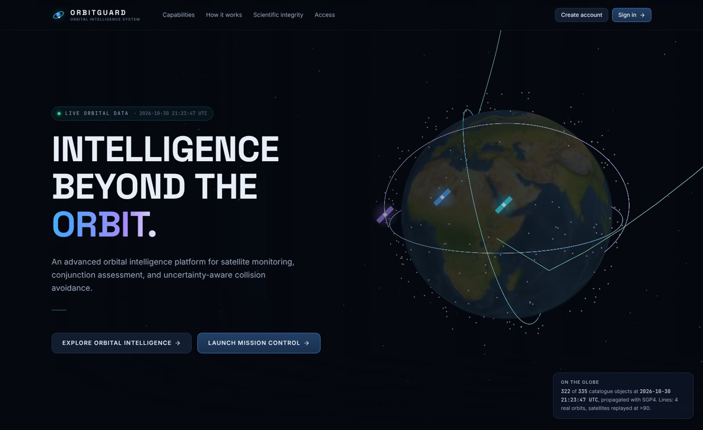

# 🛰️ ORBITGUARD

### Intelligence beyond the orbit.

**An orbital intelligence platform for satellite tracking, conjunction assessment and uncertainty-aware, multi-threat collision avoidance, built so that every number can be checked.**

<p>


</p>

[Why](#why) · [Features](#features) · [The science](#science) · [Validation](#validation) · [Results](#results) · [Architecture](#architecture) · [Quick start](#quick-start)

</div>

---

<a id="why"></a>

## 🌍 Why ORBITGUARD

Low Earth orbit is getting crowded. Tens of thousands of tracked objects share the same few hundred kilometres of altitude, and every close approach forces an operator to answer three questions:

1. **Is this encounter actually dangerous?**
2. **If I move, which burn clears *every* threat, not just the worst one?**
3. **Will that burn still be safe once real-world uncertainty is taken into account?**

ORBITGUARD answers all three in one place. It ingests real orbital data, propagates every object, screens for close approaches, then designs a single burn that clears **all** nearby threats at once. It stress-tests that burn with Monte Carlo and validates it independently with a higher-fidelity model. Finally, it shows the whole story in 3D, from the danger to the burn to each avoided encounter.

> **Its defining rule: nothing is fabricated.** Every orbit, distance and probability on screen comes from stored data or a run you can inspect. Synthetic test objects are labelled `SYNTHETIC`, assumed covariances `ASSUMED` and twin bookkeeping `SIMULATED`. Failed calculations are shown as failures. The platform never commands a real spacecraft and never modifies the real catalogue.

---

## ✨ Highlights

<table>
<tr>
<td width="50%" valign="top">

### 🎯 Multi-threat avoidance
One optimised burn evaluated against **every** threat over the whole horizon. In the experiments, single-threat planning left threats unsafe and created new close approaches with nearby objects. Multi-threat planning never did.

</td>
<td width="50%" valign="top">

### 🎲 Uncertainty-aware
Each shortlisted burn is tested by Monte Carlo over initial-state, execution and secondary-object errors. The selected burn is then trimmed to the smallest Δv that stays robust.

</td>
</tr>
<tr>
<td valign="top">

### 🔬 Independently validated
Each selected burn is re-flown as a **finite burn** with the **full force model** (J2–J4, drag, Sun, Moon, SRP) at rtol 1e-11. The *entire catalogue* is then re-screened for any encounter the burn creates.

</td>
<td valign="top">

### 🎬 Cinematic, but honest
3D replays, a guided scenario visualizer, an animated close-approach view and a schematic digital twin. Every visual is driven by computed data, and the interface respects `prefers-reduced-motion`.

</td>
</tr>
<tr>
<td valign="top">

### 🔐 Six secure portals
Six roles, from super administrator to public user. Server-side sessions, scrypt password hashing and role-based access checks on **every** API endpoint, with organisation scoping and operator satellite assignments.

</td>
<td valign="top">

### 📊 Reproducible research
Experiments E1–E8 compare the proposed method with four baselines on seeded scenarios. Every run stores its inputs, seeds, force model and software versions, with CSV/JSON export.

</td>
</tr>
</table>

---

<a id="features"></a>

## 🚀 What it does

### Mission control at a glance
The **Mission Overview** gathers the live catalogue, upcoming conjunctions by time to closest approach, data-source health and the system activity timeline in one view, on one shared simulation clock.

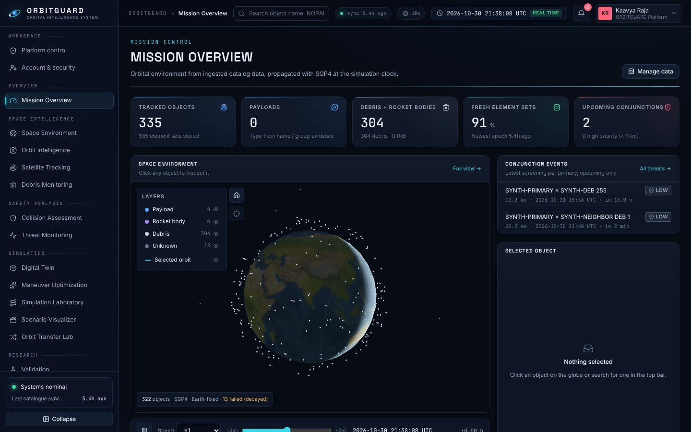

<details>
<summary><b>🌐 Space Environment & multi-satellite tracking</b></summary>
<br/>

- Every catalogue object propagated with **vectorised SGP4** and drawn on a CesiumJS globe in the Earth-fixed frame, with day/night lighting.
- Track up to **25 satellites** at once, each with its own colour, label and orbit, and hide or isolate any of them.
- **Proximity detection** gives the true 3D separation at a common time, either now or over a 1–48 h horizon, with closest approach and sphere entry/exit times refined to 10 µs.

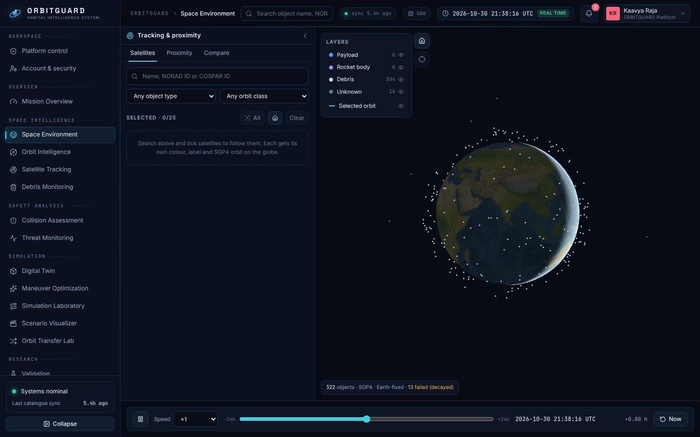
</details>

<details>
<summary><b>🧭 Orbit Intelligence & Debris Monitoring</b></summary>
<br/>

- A **six-label, multi-label** orbit classification (LEO, MEO, GEO, HEO, POLAR, SSO). Every label shows the rule that produced it; SSO is detected from the actual J2 nodal rate.
- An orbit-regime diagram, an inclination rose and altitude and inclination histograms.
- A **perigee altitude × inclination density map** of debris, rocket bodies and unknown objects, where the crowded shells and planes stand out.

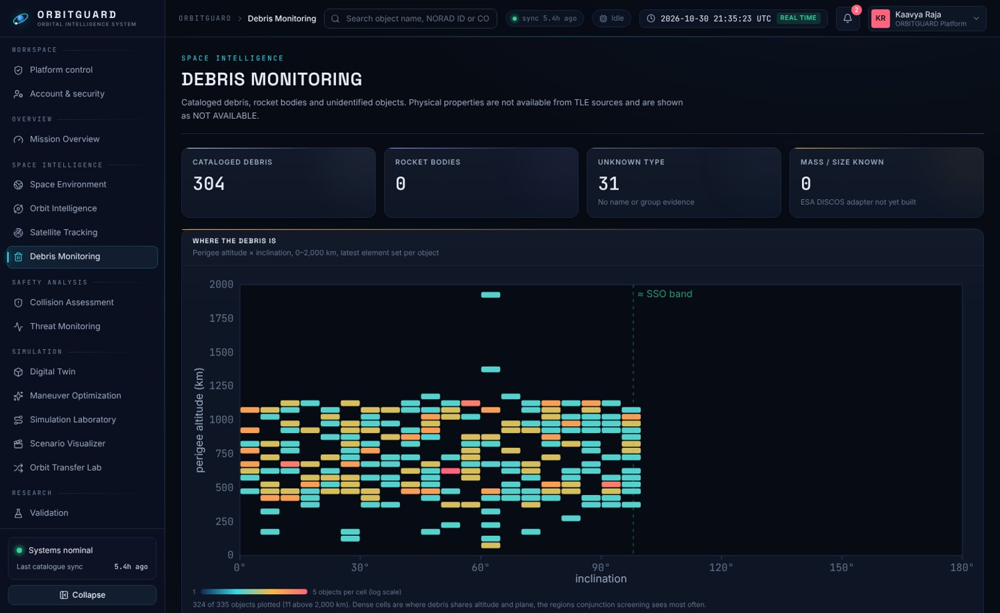
</details>

<details>
<summary><b>⚠️ Collision Assessment</b></summary>
<br/>

- Screening uses an apogee/perigee filter, then a grid search with linearised motion inside each interval, then Brent refinement of the **time of closest approach to 1 ms**.
- Encounter-plane geometry, an **animated relative-motion view** in the primary's RTN frame, and a 2-D short-encounter collision probability.
- Pc is computed **only** where covariance exists. TLE-only events show the geometry, a labelled worst-case reference, and Pc when you enter assumed uncertainties (badged `ASSUMED`).

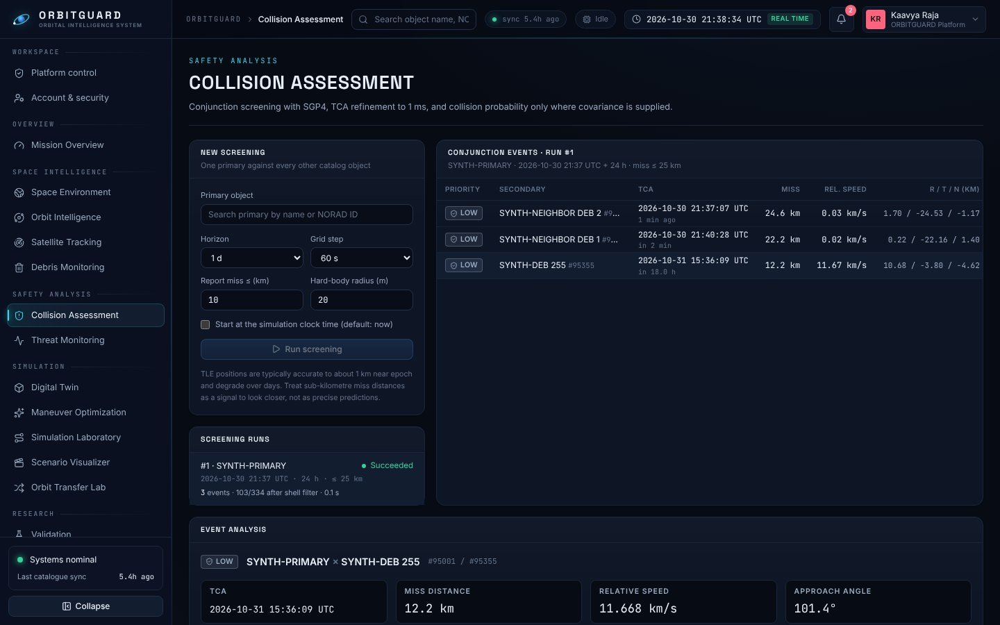
</details>

<details open>
<summary><b>🛰️ Digital Twin → Maneuver → Simulation</b></summary>
<br/>

**Digital Twin.** A configurable spacecraft (structure, propulsion templates, fuel and reserve, allowed burn directions, mission limits) whose orbit is propagated numerically. It comes with a schematic **3D model** sized from its own mass and area, and a propellant and Δv budget.

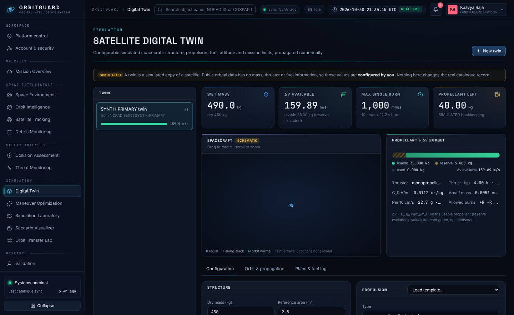

**Maneuver Optimization.** Hundreds of candidate burns are propagated, checked against hard constraints, scored, stress-tested and validated. Every rejected candidate comes with the reason it was rejected.

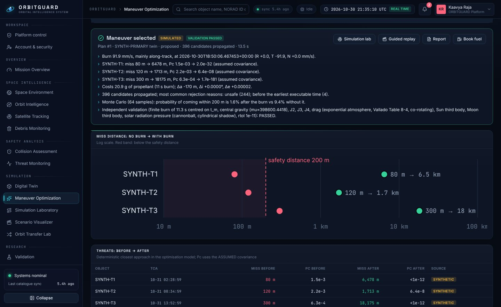

**Simulation Laboratory.** The satellite is shown in cyan until the burn. After it, green is the maneuvered path and dashed blue is the danger path it avoided. Live distance lines and *AVOIDED* tags mark each encounter.

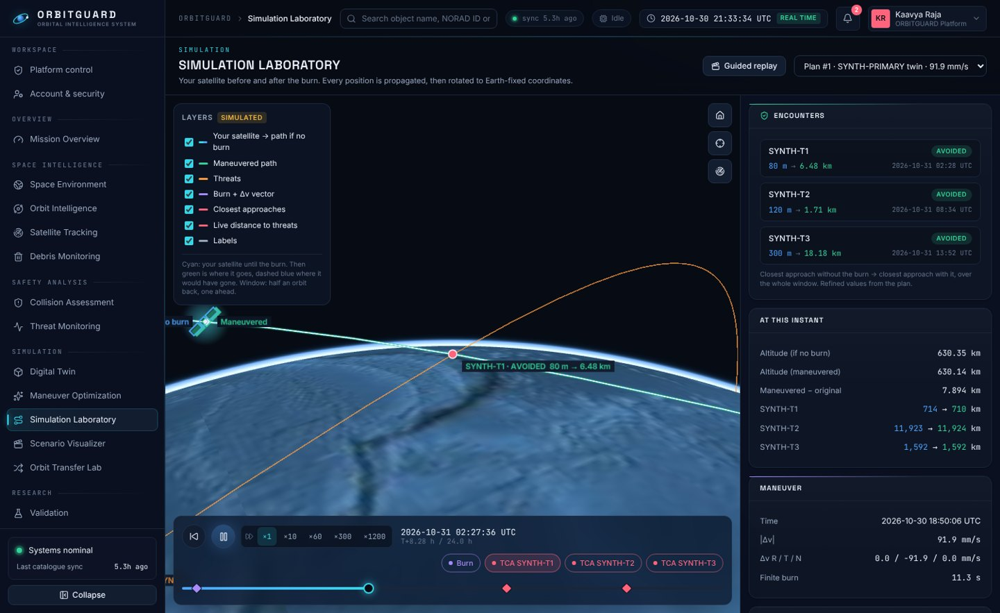

**Orbital Scenario Visualizer.** A guided, chaptered replay with camera moves: *situation → the danger → maneuver → each encounter → validation*. You can also fly another feasible candidate (amber) with the same force model to compare.

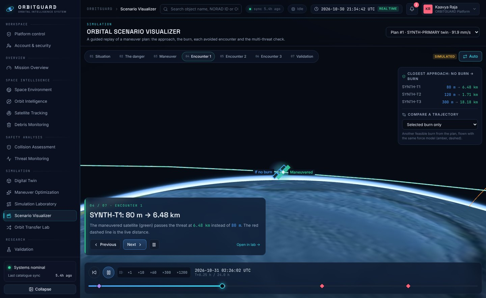
</details>

<details>
<summary><b>🔁 Orbit Transfer Lab · 📈 Research Analytics · 📄 Reports</b></summary>
<br/>

- **Transfer Lab:** Hohmann, bi-elliptic, plane change, combined transfer with an optimal split of the plane change, LEO→GEO and GTO. Each transfer is computed analytically and then **flown numerically**, so the orbit it actually reaches is shown next to the target.
- **Research Analytics:** run experiments E1–E8 from the browser and compare the methods with error bars, then download CSV or JSON.
- **Technical reports:** a printable report per plan covering inputs, provenance, threats, candidates, selection, robustness, validation and assumptions.
- **Alerts:** raised only by real events (HIGH conjunctions, finished plans and experiments). There are no decorative notifications.
</details>

---

<a id="science"></a>

## 🧪 The science

### Two propagation pathways

| | Catalogue objects | Digital twins (maneuverable) |
|---|---|---|
| **Model** | SGP4 on TLE / GP mean elements | Cowell integration of r̈ = Σ a (DOP853) |
| **Forces** | (analytical theory) | J2, J3, J4 · exponential drag with co-rotating atmosphere · Sun & Moon third body · cannonball SRP with cylindrical shadow |
| **Burns** | none | Impulsive (RTN) **and** finite (constant thrust, mass flow) |
| **Used for** | tracking, screening, threats | nominal and maneuvered trajectories |

TLE mean elements are never fed to the numerical integrator. A twin starts from the SGP4 *osculating* state of its source object at the plan epoch.

### The optimiser

Each candidate burn is **u = [tₘ, Δv_R, Δv_T, Δv_N]**. A feasible candidate minimises

$$J = w_1 R + w_2 F + w_3 M + w_4 U$$

| Term | Meaning |
|---|---|
| **R** | Collision risk: worst-threat Pc on a log scale between a target (1e-7) and the limit (1e-4). There is no credit below the target, so fuel decides once the risk is low. |
| **F** | Fuel: \|Δv\| / Δv<sub>max</sub> |
| **M** | Mission impact: change in a, i and e against the operator's tolerances |
| **U** | Uncertainty: Monte Carlo probability that any threat breaches the safety rule |

These **hard constraints** are never traded off against the score:
- Δv and propellant limits, burn duration, and allowed burn directions.
- The maneuver window.
- Altitude and inclination bands, and the eccentricity limit.
- **Sun-synchronous orbit preservation** where required.
- For **every** threat, miss distance ≥ d<sub>min</sub> **and** Pc ≤ limit.

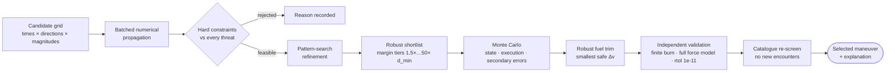

If no candidate satisfies the hard constraints and robustness, the result **says so and selects nothing**. ORBITGUARD never returns an unsafe burn.

📐 Full derivations and worked numbers: [`docs/mathematics/phase-5-8.md`](docs/mathematics/phase-5-8.md) · [`phase-4.md`](docs/mathematics/phase-4.md) · [`phase-1-2.md`](docs/mathematics/phase-1-2.md) · [`proximity.md`](docs/mathematics/proximity.md)

---

<a id="validation"></a>

## ✅ Validated against references

Each row below is an automated test or a reproducible script.

| Check | Reference | Result |
|---|---|---|
| SGP4 propagation | Vallado's published verification states (666) | max error **0.12 mm** |
| Element conversion | Vallado's osculating elements (522 states) | matches |
| Sun / Moon ephemerides | Vallado Ex. 5-1 and 5-3 | within 5e-6 AU / 1 km |
| Zonal gravity J2–J4 | finite-difference gradient of the potential | rtol 1e-7 |
| Numerical (J2–J4) vs SGP4, 24 h | independent analytical theory | **1.96 km** |
| Finite burn → impulsive limit | same Δv | Δa within 0.1 %, identical propellant |
| Hohmann LEO → GEO | Vallado Ex. 6-1: 3.935224 km/s, 5.256713 h | within 1e-5 km/s |
| Bi-elliptic transfer | Vallado Ex. 6-2: 3.904057 km/s | within 1e-4 km/s |
| Collision probability integral | analytic solution / 4 M-sample Monte Carlo | **1e-14** / within 0.4 SE |
| TCA refinement | 10 ms brute force | within 0.02 s |
| ESA Kelvins CDMs | reconstructed Mahalanobis distance vs ESA | within **0.4 %** |
| Screening speed | 10,000 objects over 24 h | **1.8 s** |

Full tables: [`docs/scientific-validation/`](docs/scientific-validation/)

---

<a id="results"></a>

## 📈 Research results

Experiments E1–E8 compare five methods on seeded **SYNTHETIC** scenarios: a 700 km sun-synchronous satellite and three threats with designed misses of 30–250 m. Every method is scored by an **independent** 128-sample Monte Carlo whose seed the optimiser never saw.

| Method | Safe scenarios | Independent P(violation) |
|---|---|---|
| No maneuver | 0 / 5 | 23.8 % |
| Fixed textbook burn (+T, 0.1 m/s) | 1 / 5 | n/a |
| Single-threat optimisation | 3 / 5, plus **new** violations with nearby objects | 6.6 → 11.4 % as neighbours grow |
| **Proposed (multi-threat, uncertainty-aware)** | **5 / 5** | **0.0 %** |

**Other findings:**
- **Fuel budget (E5):** a safe burn becomes reliably feasible from 0.25 m/s per burn. Below that, the optimiser reports that no acceptable maneuver exists.
- **Uncertainty (E6):** the required Δv grows with the assumed uncertainty, from 76 to 602 mm/s.

**Where the uncertainty-aware stage helps less:**
- **Strict risk target (E3):** nominal multi-threat planning is already robust (0.2 % vs 0.0 %).
- **Fuel-first target (E3):** the uncertainty-aware stage gives a real but modest gain (4.8 % → 3.4 %, for +72 % Δv).
- **Sun-synchronous constraint (E8):** it was never binding in these scenarios.

These are reported as found. With *n* = 5 per cell, they are indications, not established results. Full write-up: [`research/experiments/results/findings.md`](research/experiments/results/findings.md)

---

<a id="architecture"></a>

## 🏗️ Architecture

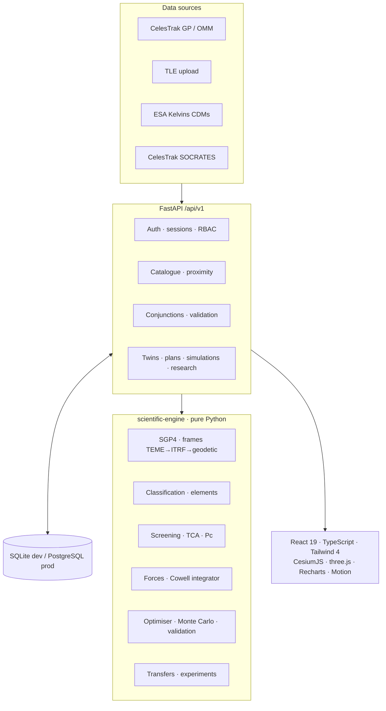

The scientific engine has **no web dependencies** and can be used on its own:

```python
from orbitguard_engine import parse_tle, classify_orbit, propagate_track
```

### Tech stack

| Layer | Technology |
|---|---|
| Science | Python · NumPy · SciPy (DOP853, Brent) · `sgp4` |
| Backend | FastAPI · SQLAlchemy 2 · Pydantic 2 · SQLite / PostgreSQL |
| Frontend | React 19 · TypeScript · Vite · Tailwind CSS 4 · Zustand |
| Visualisation | CesiumJS (globe, trajectories) · three.js (digital twin) · Recharts · Motion |
| Security | scrypt (stdlib) · HttpOnly SameSite cookies · origin checks · rate limits · single-use tokens |
| Ops | Docker Compose (PostgreSQL + nginx) |

### Security model

| Portal | Role | Typical access |
|---|---|---|
| `/login/admin` | Super Administrator | Everything, including the permission matrix |
| `/login/org-admin` | Organization Administrator | Users, fleet and assignments in their organisation |
| `/login/mission` | Mission Operations Manager | Conjunctions, twins, plans, reports |
| `/login/science` | Scientist / Research Analyst | Validation datasets, experiments, analytics |
| `/login/operator` | Satellite Operator / Engineer | Only the satellites assigned to them |
| `/login/public` | Public User | Self-registration; catalogue and transfer lab |

- **Portal check:** an account can sign in only through its own portal.
- **Lockouts and rate limits:** an account is locked for 15 minutes after five failed sign-ins, and sign-in requests are rate-limited.
- **Tokens:** sessions store only a SHA-256 hash of the token, and reset, verification and invitation tokens are single-use.
- **Enforcement:** permissions are checked on the server, never only in the browser.

Details: [`docs/security/authentication-and-rbac.md`](docs/security/authentication-and-rbac.md)

---

<a id="quick-start"></a>

## ⚡ Quick start

**Requirements:** Python 3.11+ and Node 20+.

```bash
# 1 · scientific engine + backend
cd scientific-engine && pip install -e ".[test]" && cd ..
cd backend && pip install -r requirements.txt
python -m app.cli create-superadmin --email you@example.org --name "Your Name"   # asks for a password
python -m uvicorn app.main:app --reload --port 8000                              # SQLite by default

# 2 · frontend (second terminal)
cd frontend
npm install        # also copies the Cesium runtime assets
npm run dev        # http://localhost:5173 (proxies /api to :8000)
```

Then:
1. Open **http://localhost:5173/welcome** and choose **Launch Mission Control**.
2. Sign in through the **Super Administrator** portal.
3. Open **Data Sources**, tick a CelesTrak group (for example *Space stations*) and press **Ingest**. The globe fills in when the run finishes.

<details>
<summary><b>🪟 Windows (PowerShell) notes</b></summary>
<br/>

Use `python -m uvicorn` and `python -m pytest` instead of the `.exe` launchers. Some managed Windows machines block those launchers with App Control. The project avoids compiled dependencies beyond NumPy and SciPy, and uses scrypt from the standard library.

```powershell
cd backend
python -m uvicorn app.main:app --reload --port 8000
```
</details>

<details>
<summary><b>👥 Demo accounts, Docker and the offline scenario</b></summary>
<br/>

```bash
python -m app.cli seed-demo                 # one demo account per role (asks for one password)
python -m app.cli create-user --help        # create any role from the command line
docker compose up --build                   # PostgreSQL + nginx: UI :8080, API :8000

# offline: a synthetic scenario that needs no internet
cd scientific-engine && python examples/synthetic_scenario.py > synthetic.tle
```

Upload `synthetic.tle` on **Data Sources** with a label containing *SYNTHETIC*. Every object it creates is named `SYNTH-…`. Without SMTP configured, verification and reset e-mails are printed in the backend terminal.
</details>

### Try the full workflow (about 2 minutes)

1. **Digital Twin → New twin.** Create it from a catalogue satellite.
2. **Maneuver Optimization.** Choose *Demo set* (three labelled synthetic threats), then *Optimise*.
3. **Simulation Lab** or **Guided replay.** Watch the burn and each avoided encounter.
4. **Report.** Open the printable technical report.

### Tests

```bash
cd scientific-engine && python -m pytest -q     # 103 tests: SGP4, screening, Pc, forces, optimiser, transfers, experiments
cd backend && python -m pytest -q               # 68 tests: API, auth/RBAC, proximity, validation, twin → plan → simulation
cd frontend && npm run typecheck && npm run build
python scientific-engine/examples/run_experiments.py --seeds 5   # reproduce E1–E8
```

---

## 🗂️ Repository layout

```
orbitguard/
├── scientific-engine/   orbitguard_engine: SGP4, frames, classification, screening, Pc,
│                        forces, numerical propagation, optimiser, transfers, experiments
├── backend/             FastAPI app (api, auth, models, ingestion, services), CLI and tests
├── frontend/            React + TypeScript UI: pages, 3D scenes, charts, motion components
├── docs/                mathematics · scientific validation · security · screenshots
├── research/            literature review, experiment outputs and findings
├── infrastructure/      Dockerfiles and nginx
└── data/                raw (git-ignored datasets) · processed · reference
```

<details>
<summary><b>📡 API overview (v1)</b>. Interactive docs are at <code>http://localhost:8000/docs</code>.</summary>
<br/>

| Area | Endpoints |
|---|---|
| Catalogue | `GET /stats` · `/stats/density` · `/objects` · `/objects/{id}` · `/objects/{id}/orbit` · `/positions` |
| Orbits | `POST /orbits/classify` · `/orbits/propagate` · `GET /orbits/classification-rules` |
| Ingestion | `POST /ingestion/celestrak` · `/ingestion/upload` · `GET /ingestion/runs` · `/sources` · `/activity` |
| Conjunctions | `POST /conjunctions/screen` · `GET /conjunctions` · `/conjunctions/{id}` · `POST /conjunctions/{id}/risk` |
| Tracking & proximity | `GET /objects/search` · `POST /tracking/multi-select` · `/tracking/compare` · `/proximity/screen` · `/proximity/predict` |
| Digital twins | `GET/POST /digital-twins` · `/digital-twins/{id}/propagate` · `/threats/screen` · `/apply/{plan_id}` |
| Maneuvers & simulation | `POST /maneuvers/optimize` · `GET /maneuvers/{id}` · `POST /simulations` · `GET /simulations/{id}` |
| Transfers & research | `POST /transfers` · `POST /research/experiments` · `GET .../{id}/csv` |
| Reports & alerts | `GET /reports/{plan_id}` · `GET /alerts` |
| Auth & admin | `POST /auth/login/{portal}` · `/auth/register` · `/auth/reset-password` · `/admin/*` · `/fleet/*` |
| Public | `GET /public/showcase`: anonymous and rate-limited, returning catalogue counts and a bounded SGP4 sample only |

</details>

---

## ⚖️ Honesty rules, enforced in code

- TLEs are SGP4 **mean** elements and are never shown as osculating elements without a label.
- An object's type records *how* it was determined. Mass and size show **NOT AVAILABLE** until a source provides them.
- **No collision probability is shown without covariance.** Assumed values are badged `ASSUMED`.
- SGP4 failures (decayed objects, stale elements) are shown with their error codes.
- Re-ingesting data never overwrites a stored element set; same-epoch conflicts are reported.
- Simulated results never touch the real catalogue, and no command is ever sent to a spacecraft.

## 🧭 Known limitations & roadmap

| Limitation | Next step |
|---|---|
| Static exponential atmosphere (ignores solar and geomagnetic activity) | NRLMSISE-00 with space-weather indices |
| Maneuver Pc uses **assumed** covariances | Ingest operator CDMs or Space-Track covariances |
| One burn per plan; local pattern search | Multi-burn plans and global optimisers |
| UT1 ≈ UTC, polar motion neglected in TEME → ITRF | Earth orientation parameters |
| Short-encounter Pc only | Long or slow encounter methods (for example co-located GEO) |
| Small experiment samples (*n* = 5) | 20+ seeds, full 24 h profile and a published robust baseline |
| Tables created with `create_all` | Alembic migrations · TOTP multi-factor authentication |

---

## 🙏 Acknowledgements

- **D. A. Vallado**, *Fundamentals of Astrodynamics and Applications*: algorithms and verification cases.
- **CelesTrak** (T. S. Kelso): GP data and SOCRATES.
- **ESA**: the Kelvins Collision Avoidance Challenge dataset.
- The open-source **`sgp4`**, **NumPy / SciPy**, **CesiumJS** and **three.js** projects.

---

<div align="center">

**Built by [Kaavya R](https://www.linkedin.com/in/kaavyar2006)** · B.Tech CSE (Data Science), VIT Vellore

[GitHub](https://github.com/kaavyaraja2006-create) · [LinkedIn](https://www.linkedin.com/in/kaavyar2006)

<sub>ORBITGUARD is a research platform. It uses public catalogue data and never commands a real spacecraft.</sub>

</div>
